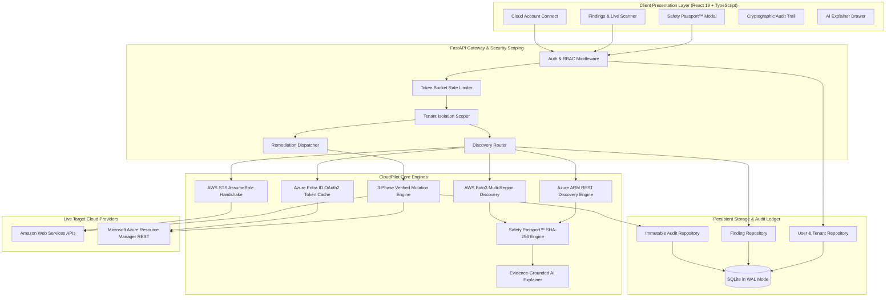
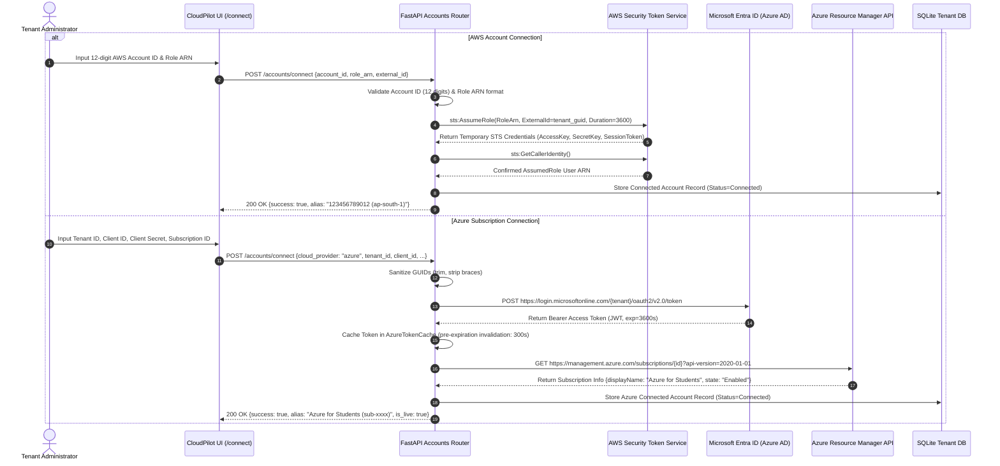
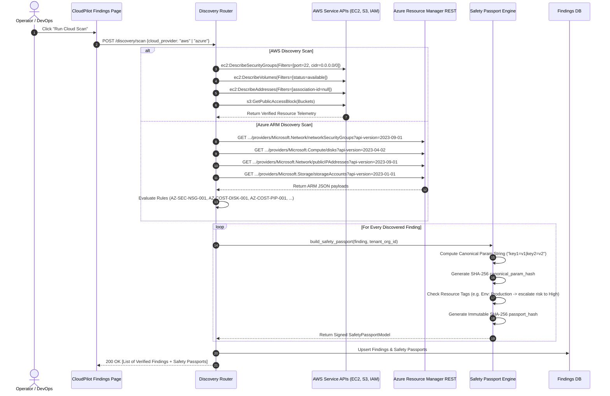
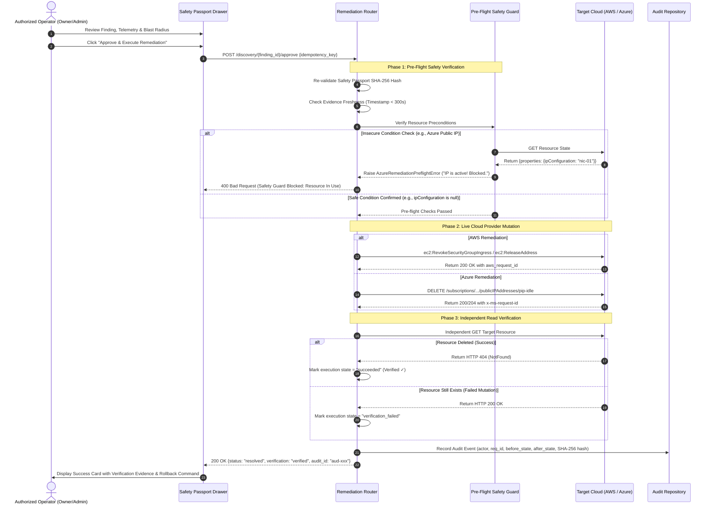
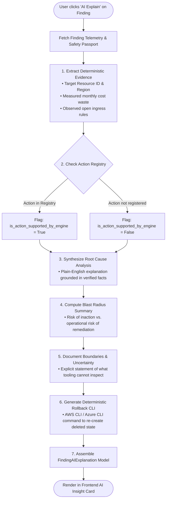
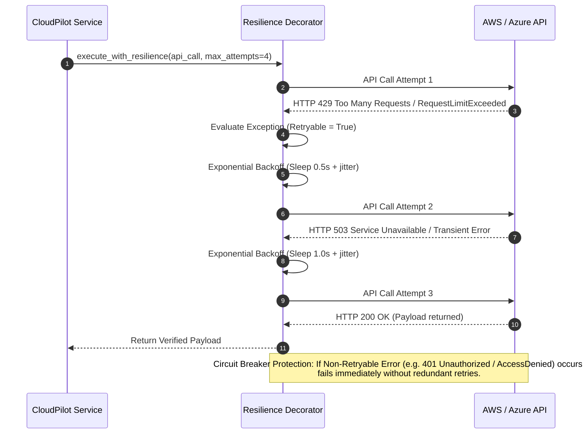

# CloudPilot Architecture & Scenario Execution Flows

This document details the architectural blueprints, execution flows, and sequence diagrams of **CloudPilot** across core operational scenarios.

---

## 1. High-Level Multi-Cloud System Architecture

---

## 2. Scenario 1: Multi-Tenant Onboarding & Cross-Account Handshake

How CloudPilot securely establishes trust with customer AWS accounts and Azure subscriptions without sharing long-term master credentials.

---

## 3. Scenario 2: Live Multi-Cloud Discovery & Safety Passport™ Issuance

Continuous evaluation of cloud resources, detection of misconfigurations, and generation of cryptographic Safety Passports.

---

## 4. Scenario 3: Human-in-the-Loop 3-Phase Verified Remediation

How CloudPilot executes mutations without risking outages, enforcing atomic execution and independent read-verification.

---

## 5. Scenario 4: Evidence-Grounded AI Explanation Engine

Advisory comprehension without hallucinations or write permissions.

---

## 6. Scenario 5: Cryptographic Audit Trail & Chain of Custody

Ensuring compliance evidence cannot be altered, forged, or repudiated.

```mermaid
flowchart LR
    subgraph EventCreation ["Remediation Event Captured"]
        E_ID[Event ID: aud-e7f12a]
        E_Actor[Actor: alice@corp.com]
        E_Action[Action: azure:.../delete]
        E_ReqID[Cloud Request ID: x-ms-req-991]
        E_Time[Timestamp: ISO-8601 UTC]
        E_Before[Before State: TCP 22 OPEN]
        E_After[After State: TCP 22 DELETED]
    end

    subgraph Hasher ["Canonical SHA-256 Integrity Engine"]
        CanonicalString["aud-e7f12a|alice@corp.com|azure:.../delete|x-ms-req-991|2026-10-23T20:00:00Z"]
        SHA[SHA-256 Hash Generator]
        IntegrityHash["Hash: a8f9c4d2...e137b"]
    end

    subgraph Ledger ["Immutable Storage"]
        DB[(SQLite Audit Table)]
    end

    EventCreation --> CanonicalString
    CanonicalString --> SHA --> IntegrityHash
    EventCreation --> DB
    IntegrityHash --> DB

    subgraph AuditorReview ["Auditor Inspection"]
        Query[Auditor Views Event] --> Recompute[Recompute SHA-256 of Canonical String]
        Recompute --> Compare{Matches Stored Hash?}
        Compare -->|Yes| Valid[Verified Untampered ✓]
        Compare -->|No| Tampered[Alert: Audit Log Tampered! ✗]
    end

    DB --> Query
```

---

## 7. Scenario 6: Failure Modes, Rate Limiting & Resilience

How CloudPilot protects itself and customer cloud accounts against API rate limiting and transient failures.

