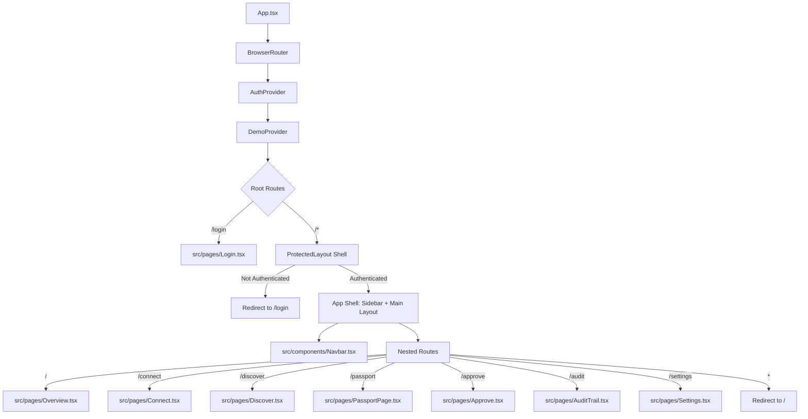
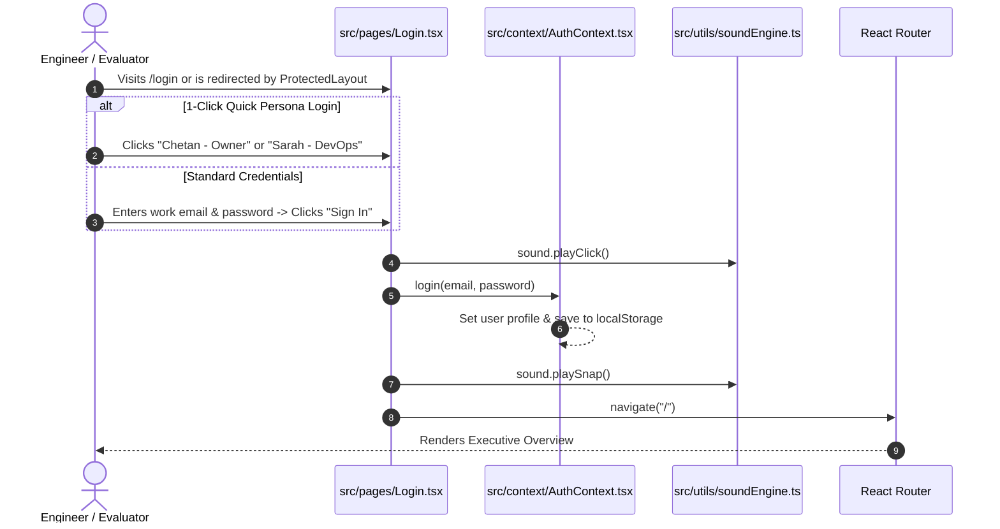
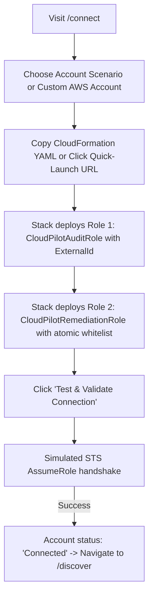
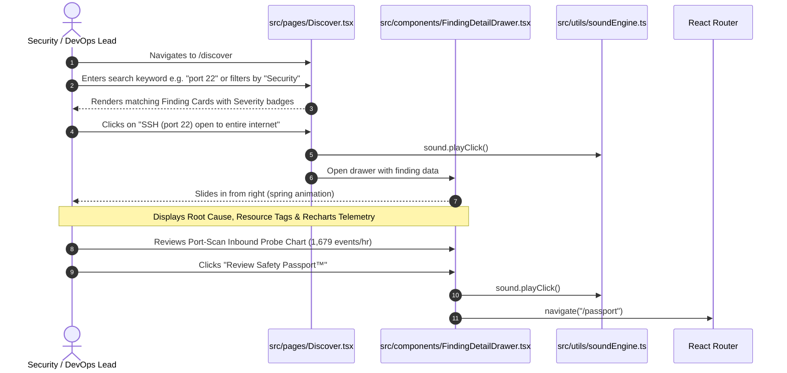
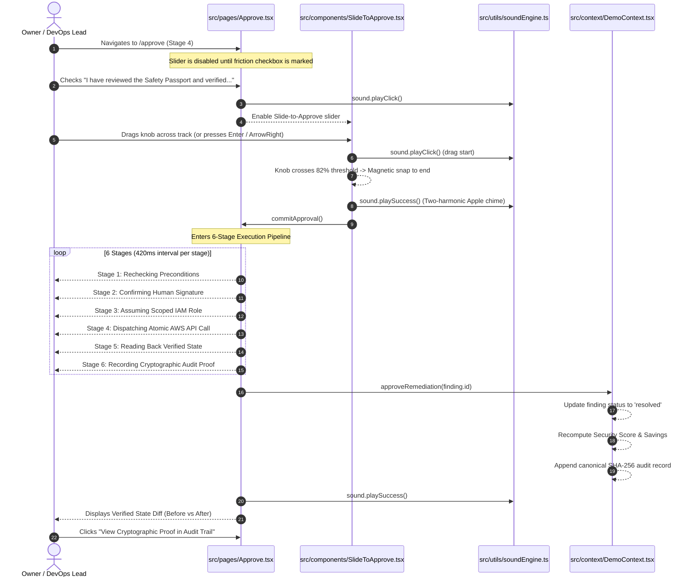
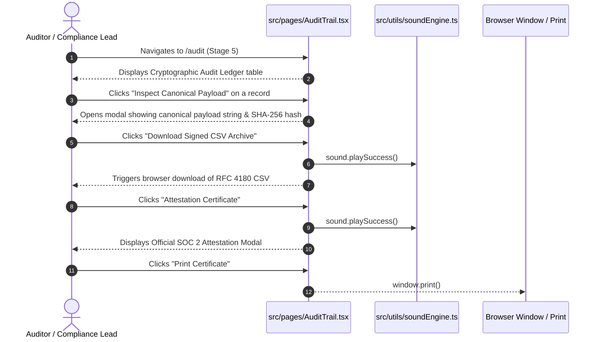
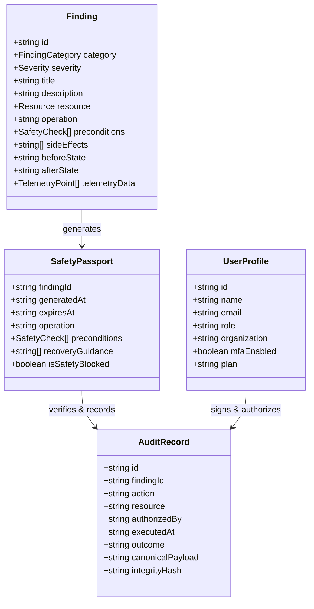

# CloudPilot — Comprehensive Frontend Architecture & Complete Flow Documentation

> **Tagline:** Understand your cloud. Approve the fix. Prove the outcome.  
> **Repository:** [github.com/chetanbhagore/CloudPilot](https://github.com/chetanbhagore/CloudPilot)  
> **Frontend Stack:** React 19 • TypeScript • Vite • Framer Motion • Recharts • Lucide React • Web Audio API  
> **Design Language:** Apple WWDC Fluid Design System (SF Pro aesthetics, spring dynamics, glassmorphism, physical friction)

---

## Table of Contents

1. [Executive Overview & Purpose](#1-executive-overview--purpose)
2. [Technology Stack & Architectural Patterns](#2-technology-stack--architectural-patterns)
3. [Repository Directory & File Organization](#3-repository-directory--file-organization)
4. [Routing & Application Shell](#4-routing--application-shell)
5. [Global State Management Architecture](#5-global-state-management-architecture)
   - [5.1 AuthContext (`src/context/AuthContext.tsx`)](#51-authcontext)
   - [5.2 DemoContext (`src/context/DemoContext.tsx`)](#52-democontext)
6. [Core User Journeys & End-to-End Flows](#6-core-user-journeys--end-to-end-flows)
   - [Flow 1: Authentication & Identity Flow (`/login`)](#flow-1-authentication--identity-flow-login)
   - [Flow 2: Multi-Account & Environment Switching Flow](#flow-2-multi-account--environment-switching-flow)
   - [Flow 3: AWS Account Onboarding Flow (`/connect`)](#flow-3-aws-account-onboarding-flow-connect)
   - [Flow 4: Telemetry Discovery & Evidence Investigation Flow (`/discover`)](#flow-4-telemetry-discovery--evidence-investigation-flow-discover)
   - [Flow 5: Digital Safety Passport™ Inspection Flow (`/passport`)](#flow-5-digital-safety-passport-inspection-flow-passport)
   - [Flow 6: Human-in-the-Loop Remediation Execution Flow (`/approve`)](#flow-6-human-in-the-loop-remediation-execution-flow-approve)
   - [Flow 7: Cryptographic Audit Trail & Compliance Verification Flow (`/audit`)](#flow-7-cryptographic-audit-trail--compliance-verification-flow-audit)
   - [Flow 8: Workspace Settings & Cloud Governance Flow (`/settings`)](#flow-8-workspace-settings--cloud-governance-flow-settings)
7. [Detailed Page-by-Page Component Breakdown](#7-detailed-page-by-page-component-breakdown)
   - [7.1 Overview Page (`src/pages/Overview.tsx`)](#71-overview-page)
   - [7.2 Connect Page (`src/pages/Connect.tsx`)](#72-connect-page)
   - [7.3 Discover Page (`src/pages/Discover.tsx`)](#73-discover-page)
   - [7.4 Passport Page (`src/pages/PassportPage.tsx`)](#74-passport-page)
   - [7.5 Approve Page (`src/pages/Approve.tsx`)](#75-approve-page)
   - [7.6 Audit Trail Page (`src/pages/AuditTrail.tsx`)](#76-audit-trail-page)
   - [7.7 Settings Page (`src/pages/Settings.tsx`)](#77-settings-page)
   - [7.8 Login Page (`src/pages/Login.tsx`)](#78-login-page)
8. [Shared Component Library](#8-shared-component-library)
   - [8.1 SlideToApprove (`src/components/SlideToApprove.tsx`)](#81-slidetoapprove)
   - [8.2 FindingDetailDrawer (`src/components/FindingDetailDrawer.tsx`)](#82-findingdetaildrawer)
   - [8.3 PassportView (`src/components/PassportView.tsx`)](#83-passportview)
   - [8.4 Navbar (`src/components/Navbar.tsx`)](#84-navbar)
   - [8.5 Sidebar (`src/components/Sidebar.tsx`)](#85-sidebar)
   - [8.6 WorkflowBreadcrumb & FindingList](#86-workflowbreadcrumb--findinglist)
9. [Web Audio API Synthesizer Engine (`src/utils/soundEngine.ts`)](#9-web-audio-api-synthesizer-engine)
10. [Data Models & TypeScript Interfaces](#10-data-models--typescript-interfaces)
11. [Design Tokens & Styling System (`src/index.css`)](#11-design-tokens--styling-system)
12. [How to Run, Build & Verify Locally](#12-how-to-run-build--verify-locally)

---

## 1. Executive Overview & Purpose

**CloudPilot** is an enterprise-grade cloud operations and governance platform built to solve the **"Cloud Anxiety Crisis"** for small engineering teams, individual developers, and academic researchers.

Traditional cloud tooling either overwhelms users with raw, unprioritized alerts (AWS CloudWatch, GuardDuty) or creates dangerous vulnerabilities through autonomous AI agents with unmonitored write access (`AdministratorAccess`).

CloudPilot bridges this gap using a **Strict Human-in-the-Loop Governance Model**:
1. **AI Explains, Never Mutates Independently:** Read-only telemetry is translated into deterministic, plain-English root cause findings.
2. **Deterministic Safety Passport™:** Prior to touching any cloud asset, CloudPilot compiles 5 automated pre-flight checks, verifies zero production blast radius, and provides a copyable rollback CLI command.
3. **Intentional Physical Friction:** High-risk actions cannot be accidentally clicked. Authorization requires active checkbox confirmation and an Apple-inspired **Slide-to-Approve** gesture with tactile haptics.
4. **Cryptographic Proof of Outcome:** Every authorized execution dispatches an atomic AWS SDK call, polls for verified state read-back, and stamps a SHA-256 tamper-evident audit receipt.

```
┌────────────────────────┐      ┌─────────────────────────┐      ┌─────────────────────────┐
│  Read-Only Telemetry   │ ───> │  AI Root-Cause Explain  │ ───> │  Safety Passport™ Pre-  │
│ (CloudPilotAuditRole)  │      │  (Deterministic Evidence│      │  Flight Verification    │
└────────────────────────┘      └─────────────────────────┘      └─────────────────────────┘
                                                                               │
                                                                               ▼
┌────────────────────────┐      ┌─────────────────────────┐      ┌─────────────────────────┐
│ Tamper-Evident SHA-256 │ <─── │ Atomic Scoped Execution │ <─── │   Human Sign-off via    │
│  Audit Ledger Proof    │      │(CloudPilotRemediation)  │      │    Slide-to-Approve     │
└────────────────────────┘      └─────────────────────────┘      └─────────────────────────┘
```

---

## 2. Technology Stack & Architectural Patterns

| Technology | Version / Tooling | Purpose in CloudPilot Frontend |
| :--- | :--- | :--- |
| **React** | `^19.3.1` | Component lifecycle, hooks, modern functional architecture. |
| **TypeScript** | `~6.0.3` | End-to-end type safety across telemetry schemas, passports, and audit records. |
| **Vite** | `^8.3.4` | Ultra-fast local dev server with HMR and optimized production bundling. |
| **React Router** | `^7.18.4` | Declarative client-side routing, protected layouts, and path resolution. |
| **Framer Motion** | `^14.5.0` | Natural spring physics, draggable gesture mechanics, smooth drawer slide-ins. |
| **Recharts** | `^3.10.1` | High-precision interactive time-series charts (CloudWatch CPU, spend run-rates). |
| **Lucide React** | `^1.61.0` | Modern, consistent iconography for cloud services, security states, and actions. |
| **Web Audio API** | Native Browser API | Zero-dependency synthetic sound engine reproducing Apple UI haptics and chimes. |
| **WebCrypto API** | Native Browser API | Native SHA-256 canonical hashing for immutable audit trail signatures. |
| **Oxlint** | `^1.88.0` | High-performance, zero-warning linting across all source files. |

---

## 3. Repository Directory & File Organization

```
cloudpilot/
├── public/                     # Static public assets
├── src/
│   ├── assets/                 # Icons and imagery
│   ├── components/             # Reusable UI component library
│   │   ├── FindingDetailDrawer.tsx # Slide-over telemetry evidence drawer
│   │   ├── FindingList.tsx     # Compact findings list component
│   │   ├── Navbar.tsx          # Top navbar (account switcher, notifs, audio toggle)
│   │   ├── PassportView.tsx    # Digital Safety Passport™ layout and checks
│   │   ├── PitchHud.tsx        # Pitch and evaluation HUD
│   │   ├── Sidebar.tsx         # Persistent left navigation sidebar
│   │   ├── SlideToApprove.tsx  # Apple-style draggable authorization slider
│   │   └── WorkflowBreadcrumb.tsx # 5-stage progress indicator
│   ├── context/                # React Contexts and state providers
│   │   ├── AuthContext.tsx     # User authentication, RBAC, notifications
│   │   ├── authDefinition.ts   # AuthContext types, interfaces, and defaults
│   │   ├── DemoContext.tsx     # Scenarios, findings, remediation, audit state
│   │   ├── contextDefinition.ts# DemoContext types, filter types, interfaces
│   │   ├── useAuth.ts          # Custom consumer hook for AuthContext
│   │   └── useDemo.ts          # Custom consumer hook for DemoContext
│   ├── data/
│   │   └── mockData.ts         # Deterministic AWS findings, accounts, and telemetry
│   ├── pages/                  # Top-level view routes
│   │   ├── Approve.tsx         # Stage 4: Slide-to-Approve & 6-stage execution
│   │   ├── AuditTrail.tsx      # Stage 5: Cryptographic audit ledger & CSV export
│   │   ├── Connect.tsx         # Stage 1: CloudFormation 2-role account onboarding
│   │   ├── Discover.tsx        # Stage 2: Finding discovery, filtering & telemetry
│   │   ├── Login.tsx           # Authentication, SSO & quick persona login
│   │   ├── Overview.tsx        # Executive summary, security score & spend trends
│   │   ├── PassportPage.tsx    # Stage 3: Dedicated Safety Passport view
│   │   └── Settings.tsx        # Workspace management, team RBAC, AWS roles
│   ├── utils/
│   │   └── soundEngine.ts      # Apple-style Web Audio synthesizer
│   ├── App.css                 # Application layout styling overrides
│   ├── App.tsx                 # Root router & protected layout hierarchy
│   ├── index.css               # Apple design system tokens, typography & CSS variables
│   └── main.tsx                # React DOM mount point
├── package.json                # Project dependencies and npm scripts
├── tsconfig.json               # Root TypeScript configuration
└── vite.config.ts              # Vite configuration
```

---

## 4. Routing & Application Shell

The application routing is configured in [src/App.tsx](file:///g:/Chetan/Chetan%20mini%20project/cloudpilot/src/App.tsx) using `react-router-dom`:



### Route Map Table

| Route Path | Page Component | Governance Stage | Description |
| :--- | :--- | :---: | :--- |
| `/login` | `Login.tsx` | Entry | Enterprise SSO, credentials, and 1-click persona quick-login. |
| `/` | `Overview.tsx` | Dashboard | Executive dashboard: Security Score, monthly waste, spend trajectory. |
| `/connect` | `Connect.tsx` | Stage 1 | Multi-account AWS onboarding via Two-Role IAM CloudFormation stacks. |
| `/discover` | `Discover.tsx` | Stage 2 | Telemetry findings hub with live search, filters, and evidence drawer. |
| `/passport`| `PassportPage.tsx` | Stage 3 | Safety Passport inspection: pre-conditions, blast radius, rollback CLI. |
| `/approve` | `Approve.tsx` | Stage 4 | Friction gate (acknowledgment + Slide-to-Approve) & 6-stage execution. |
| `/audit` | `AuditTrail.tsx` | Stage 5 | Cryptographic audit ledger with SHA-256 hashes, certificates & CSV export. |
| `/settings`| `Settings.tsx` | Workspace | User profile, team RBAC, two-person rule toggle, AWS roles & billing. |

---

## 5. Global State Management Architecture

CloudPilot utilizes two core React Context providers configured at the application root:

### 5.1 AuthContext
**File:** [src/context/AuthContext.tsx](file:///g:/Chetan/Chetan%20mini%20project/cloudpilot/src/context/AuthContext.tsx)  
**Hook:** `useAuth()`

Manages the authenticated user's session, organization identity, team RBAC permissions, and real-time cloud notifications.

#### State & Capabilities
* **`user: UserProfile`**:
  * Default: `Chetan Bhagore` (`chetan@cloudpilot.io`), Role: `Owner`.
  * Organization: `Acme Cloud Technologies` (`acme-cloud.cloudpilot.io`).
  * Subscription: `Startup Pro ($149/mo)`.
  * Security: Hardware MFA Active (FIDO2 / YubiKey token).
* **`teamMembers: TeamMember[]`**:
  * Full team roster with active and invited states (`Sarah Jenkins` - DevOps, `Alex Rivera` - Security Analyst, `Priya Sharma` - Admin).
* **`notifications: CloudNotification[]`**:
  * Real-time alert feed tracking critical exposures, idle spend, and audit receipts.
  * Tracks `unreadCount`, `markNotificationRead(id)`, `markAllNotificationsRead()`.
* **`isAuthenticated: boolean`**:
  * Persisted in `localStorage` under `cloudpilot_auth_state`.
  * Methods: `login(email, password)` and `logout()`.
* **`updateUser(updates)`**: Dynamic mutation of profile details.
* **`inviteTeamMember(email, role)`**: Add new colleagues with assigned RBAC roles.

---

### 5.2 DemoContext
**File:** [src/context/DemoContext.tsx](file:///g:/Chetan/Chetan%20mini%20project/cloudpilot/src/context/DemoContext.tsx)  
**Hook:** `useDemo()`

Governs live cloud findings, active scenario switching, account configurations, remediation execution, and cryptographic audit records.

#### State & Capabilities
* **`activeScenario: ScenarioType`**:
  * `'fintech'`: Production Core (`123456789012`, `ap-south-1`) — SSH port 22 open vulnerability.
  * `'student'`: Research & ML Lab Sandbox (`987654321098`, `us-east-1`) — Idle `p3.2xlarge` GPU instance burning $2,203/mo.
* **`findings: Finding[]`**:
  * Active findings list synchronized with the selected account scenario.
* **`resolvedFindingIds: string[]`**:
  * Tracks successfully remediated finding IDs during the active session.
* **`selectedFindingId: string`**:
  * The finding currently selected for Safety Passport review and approval.
* **`getActiveFinding(): Finding`**:
  * Resolves the full finding object based on `selectedFindingId`.
* **`approveRemediation(findingId?: string): Promise<void>`**:
  * Marks the finding as `resolved`.
  * Updates security score (+28% on FinTech, +32% on Student).
  * Recalculates monthly waste ($0 waste after resolution).
  * Generates canonical payload and native SHA-256 cryptographic hash.
  * Appends verified receipt to `auditRecords`.
  * Pushes success notification to `AuthContext`.
* **`accountConfig: AccountConfig`**:
  * Real-time configuration of the active AWS connection (`alias`, `accountId`, `region`, `roleName`, `isConnected`).
* **Filters & Sort State for Discover:**
  * `categoryFilter`: `'all' | 'security' | 'cost'`
  * `statusFilter`: `'all' | 'open' | 'resolved' | 'blocked'`
  * `searchQuery`: live string query across finding titles, rules, descriptions, and resource IDs.
  * `sortOption`: `'severity' | 'savings' | 'newest'`
* **`exportAuditCSV()`**:
  * Generates and downloads an RFC 4180-compliant `.csv` file containing the full audit ledger with SHA-256 hashes.

---

## 6. Core User Journeys & End-to-End Flows

### Flow 1: Authentication & Identity Flow (`/login`)



**Key Highlights:**
* Evaluator quick-access buttons fill in credentials with 1 click.
* Validates against empty inputs with error messages.
* Remembers session in browser `localStorage`.
* Full support for SSO buttons (AWS IAM Identity Center, Google Workspace, GitHub).

---

### Flow 2: Multi-Account & Environment Switching Flow

```mermaid
sequenceDiagram
    autonumber
    actor User as Cloud Platform Lead
    participant Navbar as src/components/Navbar.tsx
    participant DemoCtx as src/context/DemoContext.tsx
    participant Sound as src/utils/soundEngine.ts

    User->>Navbar: Clicks Account Switcher dropdown
    Navbar-->>User: Displays connected accounts list
    User->>Navbar: Selects "Research & ML Lab Sandbox (us-east-1)"
    Navbar->>Sound: sound.playClick()
    Navbar->>DemoCtx: setScenario("student")
    DemoCtx-->>DemoCtx: Update accountConfig (987654321098, us-east-1)
    DemoCtx-->>DemoCtx: Load STUDENT_FINDINGS ($2,203/mo GPU waste)
    DemoCtx-->>DemoCtx: Recalculate metrics (Security Score: 38%, Waste: $2,203)
    Navbar-->>User: Closes menu; Entire UI instantly re-hydrates for ML Lab
```

---

### Flow 3: AWS Account Onboarding Flow (`/connect`)

This flow demonstrates CloudPilot's **Two-Role IAM Trust Architecture**:
1. **`CloudPilotAuditRole` (Role 1):** Read-only security audit and view access. Configured with a customer-specific `sts:ExternalId` to prevent the Confused Deputy problem.
2. **`CloudPilotRemediationRole` (Role 2):** Scoped strictly to atomic mutation APIs (e.g. `ec2:RevokeSecurityGroupIngress`, `ec2:StopInstances`), assumed *only* upon explicit human approval.



---

### Flow 4: Telemetry Discovery & Evidence Investigation Flow (`/discover`)



---

### Flow 5: Digital Safety Passport™ Inspection Flow (`/passport`)

The **Safety Passport™** is CloudPilot's core differentiator. It provides an immutable, physical-feel pre-execution contract before anything touches the cloud.

```
┌────────────────────────────────────────────────────────────────────────┐
│                        CloudPilot Safety Passport™                     │
│  Target: sg-0a1b2c3d4e5f   •   Operation: ec2:RevokeSecurityGroupIngress│
├────────────────────────────────────────────────────────────────────────┤
│  [✓] Pre-Flight Checks:                                                │
│      1. Target Resource Exists and is Active                           │
│      2. Current Inbound Rule Matches Exact 0.0.0.0/0:22 Specification   │
│      3. No active bastion session dependent on direct ingress          │
│      4. Session Manager (SSM) alternate connectivity available         │
│      5. Caller identity verified with remediation role assumption      │
│                                                                        │
│  [✓] Blast Radius Analysis: 1 Security Group, 2 EC2 instances affected │
│  [✓] Rollback CLI: aws ec2 authorize-security-group-ingress ...        │
│  [✓] Verification Check: DescribeSecurityGroups verify rule removal    │
└────────────────────────────────────────────────────────────────────────┘
```

* **Copyable Rollback Command:** Users can copy the exact AWS CLI command with one click to reverse the action if ever required.
* **Safety Blocker Notice:** If any precondition check fails (e.g., active production dependency detected), the passport displays a high-visibility amber banner and **physically blocks execution**.

---

### Flow 6: Human-in-the-Loop Remediation Execution Flow (`/approve`)

CloudPilot rejects autonomous unmonitored scripts in favor of intentional human friction.



---

### Flow 7: Cryptographic Audit Trail & Compliance Verification Flow (`/audit`)



---

### Flow 8: Workspace Settings & Cloud Governance Flow (`/settings`)

The Settings view provides comprehensive multi-tab enterprise governance:
1. **Profile & Security Tab:** Update user name, work email, organization name, and inspect hardware MFA status (FIDO2 / YubiKey token).
2. **Team & Access Control Tab:** View the team roster with assigned roles (`Owner`, `DevOps Lead`, `Security Analyst`, `Admin`), open the "Invite Colleague" modal, and toggle the **"Enforce Two-Person Approval on Critical Fixes"** security policy.
3. **AWS Two-Role IAM Integrations Tab:** Inspect connected AWS accounts, Role ARNs, and External IDs.
4. **Plan & Billing Tab:** Manage the Startup Pro plan ($149/mo), review account quota usage (2 of 10 accounts), view card on file, and download past invoices.

---

## 7. Detailed Page-by-Page Component Breakdown

### 7.1 Overview Page
* **File:** [src/pages/Overview.tsx](file:///g:/Chetan/Chetan%20mini%20project/cloudpilot/src/pages/Overview.tsx)
* **Route:** `/`
* **Features:**
  * **Apple Keynote Showcase:** Dark studio showcase container with radial lighting and brand badge.
  * **Metric Row:** 4 interactive metric cards:
    * *Security Posture Score:* Visual progress bar with dynamic color grading (34% warning -> 62% green on remediation).
    * *Monthly Cloud Waste:* Real-time dollar tally ($2,203/mo -> $0.00/mo).
    * *Critical Vulnerabilities:* Count badge with severity colors.
    * *Verified Resolutions:* Dynamic counter of completed fixes.
  * **Recharts Spend Trajectory:** Dual-line area chart showing actual 7-day spend vs projected run-rate impact post-remediation.
  * **Actionable Findings Preview:** Direct button to review active Safety Passport or navigate to Discover.

---

### 7.2 Connect Page
* **File:** [src/pages/Connect.tsx](file:///g:/Chetan/Chetan%20mini%20project/cloudpilot/src/pages/Connect.tsx)
* **Route:** `/connect`
* **Features:**
  * **Preset Scenarios & Custom Accounts:** Switch between FinTech Production, Research Sandbox, or connect a custom AWS account.
  * **CloudFormation Stack Templates:**
    * Role 1 Template: `CloudPilotAuditRole` (`SecurityAudit`, `ViewOnlyAccess`, `sts:ExternalId`).
    * Role 2 Template: `CloudPilotRemediationRole` (Whitelisted atomic actions).
  * **1-Click Copy YAML:** Copies complete YAML templates to clipboard.
  * **Validation State Machine:** Simulates connection testing with animated loading spinners, region validation, and success badges.

---

### 7.3 Discover Page
* **File:** [src/pages/Discover.tsx](file:///g:/Chetan/Chetan%20mini%20project/cloudpilot/src/pages/Discover.tsx)
* **Route:** `/discover`
* **Features:**
  * **Live Search & Multidimensional Filtering:**
    * Search query input (instant filtering across title, description, rule, resource ID).
    * Category filter pills: `All`, `Security Exposures`, `Cost Leaks`.
    * Status filter pills: `All`, `Open`, `Resolved`, `Blocked`.
    * Sorting dropdown: `Highest Severity`, `Highest Savings`, `Newest`.
  * **Simulated Deep Telemetry Scan:** `Run Deep Scan` button triggers simulated AWS API sweeps across 47 resources.
  * **Card Grid:** Displays severity pill, resource tag, detection timestamp, estimated dollar impact, and "Investigate" action.
  * **Integration with Drawer:** Clicking any card opens `FindingDetailDrawer`.

---

### 7.4 Passport Page
* **File:** [src/pages/PassportPage.tsx](file:///g:/Chetan/Chetan%20mini%20project/cloudpilot/src/pages/PassportPage.tsx)
* **Route:** `/passport`
* **Features:**
  * Dedicated container rendering the `PassportView` component for the currently active finding.
  * Includes workflow stage breadcrumbs and navigation buttons to advance to `/approve`.

---

### 7.5 Approve Page
* **File:** [src/pages/Approve.tsx](file:///g:/Chetan/Chetan%20mini%20project/cloudpilot/src/pages/Approve.tsx)
* **Route:** `/approve`
* **Features:**
  * **Human Friction Gate:** Mandatory acknowledgment checkbox to unlock execution.
  * **Draggable Slider:** `SlideToApprove` component with magnetic spring physics and keyboard support.
  * **Safety Blocker Notification:** Explicitly prevents execution if pre-flight checks fail.
  * **6-Stage Execution Pipeline:** Believable sequential animation showing role assumption, atomic API dispatch, and read-back polling.
  * **Verified State Diff Card:** High-contrast Before vs After comparison displaying the verified outcome and author attribution.

---

### 7.6 Audit Trail Page
* **File:** [src/pages/AuditTrail.tsx](file:///g:/Chetan/Chetan%20mini%20project/cloudpilot/src/pages/AuditTrail.tsx)
* **Route:** `/audit`
* **Features:**
  * **Cryptographic Ledger Banner:** Emphasizes non-repudiation and SOC 2 compliance.
  * **Audit Records Table:** Displays Record ID, Scenario, Action, Resource, Author, Timestamp, and Outcome.
  * **Canonical Payload Inspector:** Modal showing the exact pipe-delimited string hashed with SHA-256.
  * **Attestation Certificate Modal:** Printable executive certificate certifying cryptographic integrity.
  * **CSV Export:** One-click download of the complete compliance archive.

---

### 7.7 Settings Page
* **File:** [src/pages/Settings.tsx](file:///g:/Chetan/Chetan%20mini%20project/cloudpilot/src/pages/Settings.tsx)
* **Route:** `/settings`
* **Features:**
  * 4 navigation tabs: `Profile & Security`, `Team & Access`, `AWS Integrations`, `Billing & Plan`.
  * Team member invitation modal with RBAC role dropdown.
  * Two-Person Approval policy toggle for critical changes.
  * CloudFormation template viewer and subscription quota usage bar.

---

### 7.8 Login Page
* **File:** [src/pages/Login.tsx](file:///g:/Chetan/Chetan%20mini%20project/cloudpilot/src/pages/Login.tsx)
* **Route:** `/login`
* **Features:**
  * Clean, high-converting enterprise SaaS split layout.
  * 1-Click quick login buttons for evaluators (`Chetan - Owner` and `Sarah - DevOps`).
  * SSO integration options (AWS IAM Identity Center, Google, GitHub).
  * Product trust indicators: Two-Role IAM, 99.98% safe execution rate, customer testimonial.

---

## 8. Shared Component Library

### 8.1 SlideToApprove
* **File:** [src/components/SlideToApprove.tsx](file:///g:/Chetan/Chetan%20mini%20project/cloudpilot/src/components/SlideToApprove.tsx)
* **Mechanics:**
  * Uses Framer Motion's `drag="x"` with elastic constraints and spring snapping (`damping: 24`, `stiffness: 300`).
  * Dynamic color and opacity interpolations via `useTransform` (text fades out as knob progresses, background fills with emerald green).
  * 82% drag distance commitment threshold; snaps back with tactile sound if released prematurely.
  * **Full Keyboard Accessibility:** Supports `Enter`, `Space`, and `ArrowRight` keys for screen reader and keyboard-only users.

---

### 8.2 FindingDetailDrawer
* **File:** [src/components/FindingDetailDrawer.tsx](file:///g:/Chetan/Chetan%20mini%20project/cloudpilot/src/components/FindingDetailDrawer.tsx)
* **Mechanics:**
  * Slides out from the right with spring physics (`damping: 30`, `stiffness: 320`).
  * Closes on backdrop click or `Escape` keypress.
  * Contains an interactive Recharts `AreaChart` rendering specific CloudWatch telemetry (e.g. CPU utilization, port scan probes).
  * Displays resource metadata, tags, and direct CTA to navigate to `/passport`.

---

### 8.3 PassportView
* **File:** [src/components/PassportView.tsx](file:///g:/Chetan/Chetan%20mini%20project/cloudpilot/src/components/PassportView.tsx)
* **Mechanics:**
  * Physical-feel digital card with top dark ribbon and shield seal.
  * Lists 5 pre-flight checks with green checkmarks or amber blocker badges.
  * Code block containing the deterministic rollback CLI command with a copy button.
  * Discloses side effects, blast radius, and post-execution verification steps.

---

### 8.4 Navbar
* **File:** [src/components/Navbar.tsx](file:///g:/Chetan/Chetan%20mini%20project/cloudpilot/src/components/Navbar.tsx)
* **Mechanics:**
  * Multi-account switcher dropdown with active checkmark.
  * Notification center drawer with unread count badge.
  * Audio synthesizer mute/unmute toggle.
  * User profile dropdown with sign-out action.

---

### 8.5 Sidebar
* **File:** [src/components/Sidebar.tsx](file:///g:/Chetan/Chetan%20mini%20project/cloudpilot/src/components/Sidebar.tsx)
* **Mechanics:**
  * Operations navigation (`Overview`, `Discover`, `Safety Passport`, `Approve & Act`, `Audit Trail`).
  * Governance navigation (`AWS Accounts`, `Settings & Team`).
  * Dynamic counter badges (e.g., number of open findings, resolution status).
  * Connected account mini-card and persistent user identity card with sign-out.

---

### 8.6 WorkflowBreadcrumb & FindingList
* **WorkflowBreadcrumb:** Visual 5-stage progress indicator (`Connect -> Discover -> Passport -> Approve -> Audit`) highlighting the current governance stage.
* **FindingList:** Compact list of findings for dashboard widgets and quick previews.

---

## 9. Web Audio API Synthesizer Engine

**File:** [src/utils/soundEngine.ts](file:///g:/Chetan/Chetan%20mini%20project/cloudpilot/src/utils/soundEngine.ts)

CloudPilot features a zero-dependency, synthesized audio engine that creates tactile feedback inspired by Apple UI haptics:

| Sound Method | Synthesis Waveform & Frequency | Purpose |
| :--- | :--- | :--- |
| `playClick()` | Sine wave: 1200 Hz ramping to 400 Hz (35ms duration) | Soft tactile tick on button clicks, tab switches, and checkbox toggles. |
| `playSnap()` | Triangle wave: 580 Hz ramping to 220 Hz (50ms duration) | Latch sound when slider snaps back or dialogs close. |
| `playSuccess()` | Dual-sine chord: F#5 (739.99 Hz) & A#5 (932.33 Hz) with 80ms stagger | Warm two-harmonic Apple chime on successful execution, verification & export. |
| `playWarning()` | Sine wave: 320 Hz ramping to 260 Hz (120ms duration) | Subtle alert cue when encountering blocked checks or warnings. |

* **User Control:** Users can toggle sound effects on/off via the speaker icon in the top navbar; preferences are saved in `localStorage.getItem('cloudpilot_sound')`.

---

## 10. Data Models & TypeScript Interfaces

**Files:** [src/data/mockData.ts](file:///g:/Chetan/Chetan%20mini%20project/cloudpilot/src/data/mockData.ts), [src/context/authDefinition.ts](file:///g:/Chetan/Chetan%20mini%20project/cloudpilot/src/context/authDefinition.ts), [src/context/contextDefinition.ts](file:///g:/Chetan/Chetan%20mini%20project/cloudpilot/src/context/contextDefinition.ts)



---

## 11. Design Tokens & Styling System

**File:** [src/index.css](file:///g:/Chetan/Chetan%20mini%20project/cloudpilot/src/index.css)

CloudPilot is styled strictly with curated CSS variables and utility classes adhering to the **Apple WWDC Fluid Design Standard**:

* **Canvas & Surface Palette:**
  * Background Canvas: `#F5F5F7` (soft warm white)
  * Card Surfaces: `#FFFFFF` (pure white with subtle borders)
  * Secondary Surfaces: `rgba(0, 0, 0, 0.03)`
* **Brand Accents:**
  * Apple Blue: `#0071E3` / Dark: `#0058B0`
  * Apple Emerald: `#30D158` / Dark: `#248A3D`
  * Apple Amber: `#FF9F0A` / Dark: `#B26A00`
  * Apple Crimson: `#FF453A` / Dark: `#D70015`
* **Translucency & Materials:**
  * `backdrop-filter: blur(28px) saturate(180%)` on top navigation and overlays.
* **Typography:**
  * Font Stack: `-apple-system, BlinkMacSystemFont, "SF Pro Display", "SF Pro Text", "Inter", sans-serif`.
  * Display titles feature negative letter-spacing (`-0.026em`) for a modern, crisp feel.

---

## 12. How to Run, Build & Verify Locally

### Available Scripts

```bash
# 1. Start the local development server with Hot Module Replacement (HMR)
npm run dev
# Server runs at: http://localhost:5173/

# 2. Run TypeScript typecheck and build the production bundle
npm run build

# 3. Run the high-performance Oxlint linter
npm run lint

# 4. Preview the production build locally
npm run preview
```

### Verification Checklist
* [x] **TypeScript:** `tsc -b` exits with code 0 (0 errors, 0 warnings).
* [x] **Production Build:** `vite build` bundles cleanly into `/dist`.
* [x] **Linting:** `oxlint` passes across all files with 0 errors.
* [x] **Audio:** Web Audio API synthesizer initializes gracefully with browser user gesture policies.
* [x] **Storage:** Session and sound preferences correctly persist in `localStorage`.
