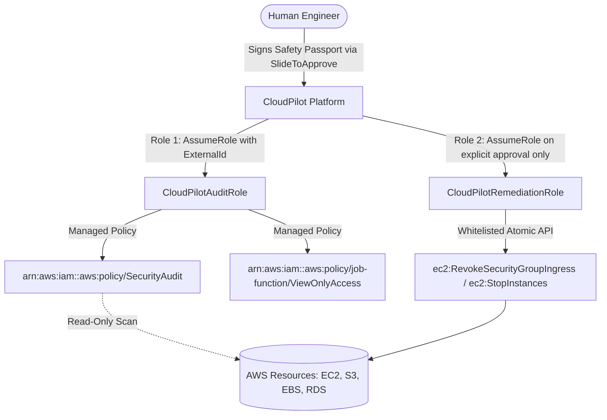

# CloudPilot — Context & Product Architecture

> **Tagline:** Understand your cloud. Approve the fix. Prove the outcome.  
> **One-Line Description:** CloudPilot helps small engineering teams, individual developers, and students identify AWS cost leaks and security exposures, understand the underlying evidence, review a transparent Safety Passport™, explicitly authorize remediation, and prove the verified outcome with cryptographic audit receipts.

---

## 1. The Problem

### 1.1 The Cloud Anxiety Crisis for Small Teams
Managing cloud infrastructure on Amazon Web Services (AWS) is notoriously intimidating for anyone without a dedicated DevOps or SecOps team. For students, solo hackers, and early-stage startups:
1. **Cryptic Billing Surprises:** A forgotten GPU instance (`p3.2xlarge`) left running over a single weekend can burn $250–$500 in student grant credits. Orphaned gp3 EBS volumes from deleted EC2 machines quietly accumulate hundreds of dollars in unseen monthly storage fees.
2. **Critical Security Blind Spots:** A developer setting up a test API inadvertently leaves SSH port 22 open to `0.0.0.0/0` (the entire internet). Within minutes, automated botnets and vulnerability scanners initiate thousands of brute-force attempts.
3. **The "Analysis Paralysis" of Existing AWS Tools:**
   * **AWS Cost Explorer & CloudWatch:** Overwhelming dashboards with hundreds of unprioritized metrics and zero actionable remediation guidance.
   * **AWS Security Hub & GuardDuty:** Alert firehoses that terrify developers without explaining *why* an issue exists or *how* to safely fix it without breaking production.
4. **The Danger of Blind Autonomous AI Agents:**
   * Traditional AI scripts and autonomous cloud agents often demand wide write access (`AdministratorAccess`), hallucinate AWS CLI commands, and execute destructive operations without human oversight.

---

## 2. The CloudPilot Solution

CloudPilot bridges the gap between passive alerting and dangerous autonomous execution through a strict **Human-in-the-Loop Governance Model**:

```
[ Read-Only Telemetry ] ──> [ AI Root-Cause Explanation ] ──> [ Safety Passport™ Pre-Check ] ──> [ Human Slide-to-Approve ] ──> [ Verified Outcome & Audit ]
```

### Core Philosophy
* **AI Explains; It Never Controls Execution:** Artificial intelligence translates raw CloudWatch telemetry and CloudTrail logs into plain, digestible English. It never executes changes independently.
* **Evidence Drives Findings:** Every security alert or cost opportunity cites deterministic, verifiable facts (e.g., zero CPU utilization over 23 days, 1,679 port-scan probe events, unattached volume states).
* **The Safety Passport™:** Before touching any cloud resource, CloudPilot generates an immutable, physical-feel digital passport documenting 5 pre-flight checks, blast radius analysis, and a deterministic CLI rollback command.
* **Friction That Protects:** High-risk actions cannot be accidentally triggered. We implement intentional physical friction: confirmation checkboxes and an Apple-style **Slide-to-Approve** slider.
* **Proving the Outcome:** Execution is followed by independent verification calls. Changes are proven via a Before-vs-After state diff and stamped with a cryptographic SHA-256 audit receipt.
* **Financial Honesty:** CloudPilot never claims estimated savings as realized profit. Run-rate impacts are explicitly flagged as simulated projections based on AWS published pricing until billing cycles close.

---

## 3. Target Audience & Personas

| Target Persona | Key Pain Point | How CloudPilot Solves It |
| :--- | :--- | :--- |
| **Students & University Researchers** | Limited grant/scholarship AWS credits burned on idle GPU training VMs and forgotten volumes. | Instant idle detection, one-click downscaling, budget alert enforcement, and student-focused sandbox presets. |
| **Solo Developers & Indie Hackers** | No DevOps background; terrified of opening security vulnerabilities while shipping MVPs. | Plain-English explanations, zero-credential onboarding, and deterministic rollback guarantees. |
| **Early-Stage Startups (Seed / Pre-A)** | Need security hygiene for enterprise customers and SOC2 readiness without hiring a $200k/yr Cloud Engineer. | Immutable cryptographic audit trails, verified state diffs, and downloadable attestation certificates. |

---

## 4. Architectural Trust Model (Two-Role IAM Isolation)

To eliminate the #1 security concern of cloud engineers (*"Why should I give a third-party tool write permissions to my cloud?"*), CloudPilot operates on a **strictly decoupled Two-Role Architecture**:



1. **Role 1 — Read-Only Discovery (`CloudPilotAuditRole`):**
   * Configured via customer AWS CloudFormation template.
   * Attached strictly to `SecurityAudit` and `ViewOnlyAccess`.
   * **Guarantee:** CloudPilot can physically never alter, restart, or delete resources during background scans.
   * **Confused Deputy Defense:** Uses unique `sts:ExternalId` per tenant.
2. **Role 2 — Scoped Remediation (`CloudPilotRemediationRole`):**
   * Whitelists only narrow atomic actions (e.g. `ec2:RevokeSecurityGroupIngress`).
   * Assumed exclusively upon explicit human signature in the UI.

---

## 5. Visual Direction & Design System

CloudPilot rejects the generic dark cyber-neon aesthetic in favor of an **Apple-inspired WWDC fluid interface design standard**:

* **Canvas & Materials:** Soft warm white canvas (`#F5F5F7`), pure white cards (`#FFFFFF`), subtle multi-layered ambient shadows, and fine translucent chrome (`backdrop-filter: blur(28px) saturate(180%)`).
* **Dark Studio Showcase:** High-contrast keynote section on the Overview page spotlighting the platform identity with radial light dispersion.
* **Typography:** SF Pro / Inter font stack with negative tracking (`letter-spacing: -0.026em` on large display titles) and high-contrast WCAG AA compliant muted labels.
* **Physicality & Motion:** Framer Motion spring physics (`damping: 24`, `stiffness: 300`, `bounce: 0.15`), magnetic snap-back on sliders, and direct manipulation.
* **Synthesized Audio Engine:** Lightweight Web Audio API synthesizer providing tactile click ticks, slider catches, and a warm two-harmonic completion chime without loading external MP3 files.
